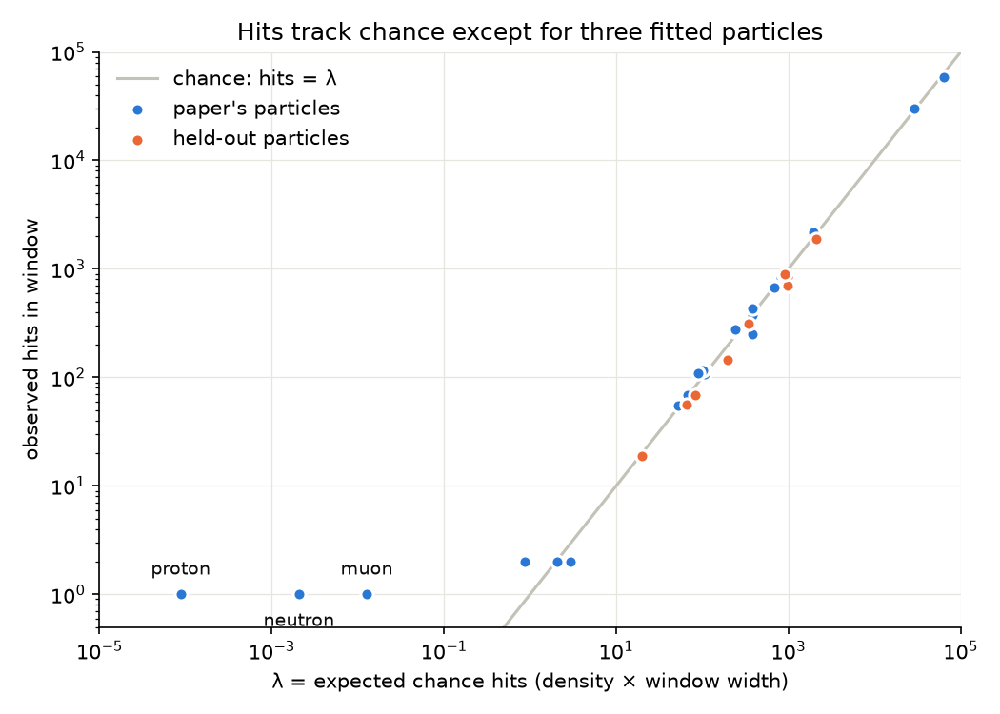
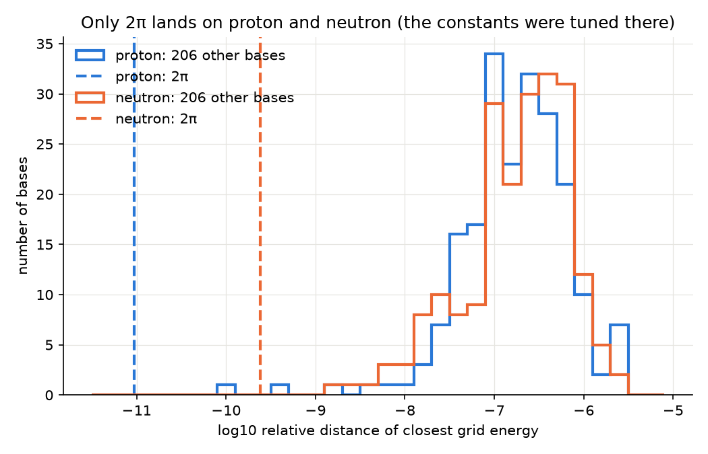

# Evaluation of the P(2π) mass formula

Reproduce everything with `make test` and `make eval` (≈10 min). The code is in
`src/polynome2pi/evaluation/` and the tests are in `tests/`.

## TL;DR

1. **The repo's formula does not match the paper.** `EnergyModel.energy` differs
   from the paper's own Fig. 3 code on 99.85 % of coefficient tuples, by up to
   0.26 mₑ. With the repo code, the paper's proton tuple gives 1835.894, not
   1836.1527. The committed results in `results/` come from this deviating formula.
2. **Almost every "match" is what chance predicts.** The full coefficient grid
   has 4.0 M non-negative energies in [0, 3718] mₑ, about 1000 per mₑ. Any
   window wider than ~10⁻³ mₑ is hit automatically. That leaves 31 matched
   windows besides the three below. For these, the observed hit count tracks
   the chance expectation λ = density × width, from λ ≈ 0.9 up to 6·10⁴. The
   median ratio of hits to λ is 1.00 (figure 1). Random fake masses with the same
   relative window widths are hit 64.9 % of the time. Chance predicts 65.3 %.
3. **Only three hits beat chance: proton, neutron, muon.** These are exactly the
   particles the hand-built constants (E_C₊, E_C₋, E₀) were constructed from. Our
   test shows that one such constant (Σ aₖπ⁻ᵏ, k = 7…14, aₖ ∈ {−2…2}) lets the
   grid hit **93.5 %** of random fake targets at proton precision. Random bases
   instead of 2π give 69–87 %. So these three hits measure how well the constants
   were tuned, not evidence for 2π.
4. **The out-of-sample tests fail.** Every target precise enough to be
   informative and not used in the construction is missed:
   - the electron (exactly 1 mₑ by definition; best value 0.9988)
   - the ¹H atom
   - muonium
   - positronium
   - the deuteron
   - the deuterium atom
5. **The one interesting coincidence.** The bare polynomial
   (2π)⁴+(2π)³+(2π)²−(2π)−1−(2π)⁻¹ = 1838.6317 is 2.8·10⁻⁵ from mₙ/mₑ. The
   chance of this for one fixed target is about 0.6 %. That is comparable to
   Lenz's 1951 observation 6π⁵ ≈ mₚ/mₑ (1.9·10⁻⁵). Counting how many targets
   and forms could have been tried, it is not significant.

**Conclusion:** with the data in this repo, there is no statistical evidence that
P(2π) describes particle masses beyond what a dense spectrum plus tuned constants
produces.

## 1. Code correctness

| Check | Result |
|---|---|
| Committed `results/` reproduce from original code | ✅ byte-identical (CSV, TXT) |
| Repo formula vs paper Fig. 3 code | ❌ differs on 99.85 % of tuples (E7 term) — `tests/test_paper_model.py` records it as strict xfail |
| Paper examples reproduced by paper formula | ✅ proton 1836.15267341, neutron 1838.68366245, muon 206.76828315, π⁰ 264.14345, π± 273.13259 |
| Sector cuts in `engine.py` | ❌ dead code: compares `sector.value` (`"222-c_tau"`, `"H-Atom"`) with `"heavy"` / `"nucleon"` — never true |
| m-bin index `256+32·i4+4·i3+i2` | ❌ collides once \|i2\| > 1 (e.g. (i3=1,i2=−2) ≡ (i3=0,i2=2)), merging different polynomials in sectors 011+ |
| `particles.py` H atom | ❌ 1837.47 = standard atomic weight of natural hydrogen (1.008 u); ¹H is 1837.15265 mₑ |
| Electron window | ⚠ [0.995, 1.0] is artificial; the electron is exactly 1 in these units |
| ds⁺, Higgs, top | ⚠ outside the reachable range of the grid (max 3717.6 mₑ), so "all particles" is not covered |
| `src/fuer_papa.py` | ⚠ builds `ARGS` but never uses it; always runs all sectors |

Paper-internal inconsistencies found while transcribing:
- The neutron and proton tuple labels are swapped relative to the code: neutron is C = 0, proton is C = 1.
- One muon tuple, on p. 8, is wrong.
- The sign of 2π⁻¹⁴ in E_C₊ differs between Fig. 2 and eq. 2.7.
- The summary contains the recursive definition "E_C₋ = 2π − π⁻¹ + E_C₋".

## 2. Hits vs chance (2π, full grid = union of all sectors)

| particle | window (mₑ) | hits | λ (chance) | verdict |
|---|---|---|---|---|
| proton | 6.4e-8 | 1 | 8.8e-5 | beats chance — fitted via E_C₊ |
| neutron | 1.5e-6 | 1 | 2.1e-3 | beats chance — fitted via E₀ |
| muon | 9.2e-6 | 1 | 1.3e-2 | beats chance — fitted via E_C₋ |
| π±, π⁰ | 7e-4, 1.8e-3 | 2, 2 | 0.87, 2.0 | chance |
| electron (repo window) | 5e-3 | 2 | 2.9 | chance |
| K, η, ρ, ω, K*, φ, τ, D, H(repo), c, s, u, d | 0.04 … 78 | 55 … 58 860 | 52 … 62 990 | chance (hits ≈ λ) |
| electron exact, ¹H, muonium, positronium, deuteron, D atom | ≤ 2e-6 | 0 | ≤ 0.013 | miss |
| held-out baryons Λ, Σ, Ξ, Σ*, Ξ*, Ω⁻ | 0.02 … 1.3 | 19 … 1899 | 20 … 2086 | chance |

The paper's "Δi/2π probabilities" (e.g. s = 49 %) count hits in a window. As the
table shows, that count is just density × width.

## 3. Alternative bases

To test other bases, π is replaced by b/2 everywhere, including in the constants.
There are 206 alternative bases: 200 uniform in [5.5, 7] plus 6, 2e, π+3, √40,
6.5 and 7. Each is scored on the 9 sharp targets.

| | sharp hits |
|---|---|
| 2π | 3 (p, n, μ) |
| other bases | mean 0.005, max 1 (one muon hit at b = 6.2663, chance) |

2π is clearly special here, but only because the constants were designed at 2π.
Section 4 shows that the same kind of constant can be fitted for any base, and
section 2 shows that targets which weren't fitted are missed.

## 4. Tuning capacity

Take a grid energy and add one constant Σₖ₌₇¹⁴ aₖπ⁻ᵏ with aₖ ∈ {−2,…,2}. That is
390 625 options, comparable to the 8-term E_C₊. The question is what fraction of
random targets in [1800, 1900] can be hit with a ±3.2·10⁻⁸ window, i.e. proton
precision.

| base | fraction hit |
|---|---|
| 2π | 93.5 % |
| 6.5 | 69.0 % |
| random | 86.5 % |

A 10-digit proton or neutron match therefore says almost nothing once a constant
of this form is allowed.

## 5. What would count as evidence

The formula would need to predict, before looking, the masses of particles
measured to better than ~10⁻⁴ mₑ that were not used to build it. Examples:
- ¹H
- muonium
- positronium
- the deuteron
- mass differences such as mₙ − mₚ
- future precision measurements

It would also need a fixed rule for C and the correction terms. Currently every
precise target outside the fitted set is missed.
